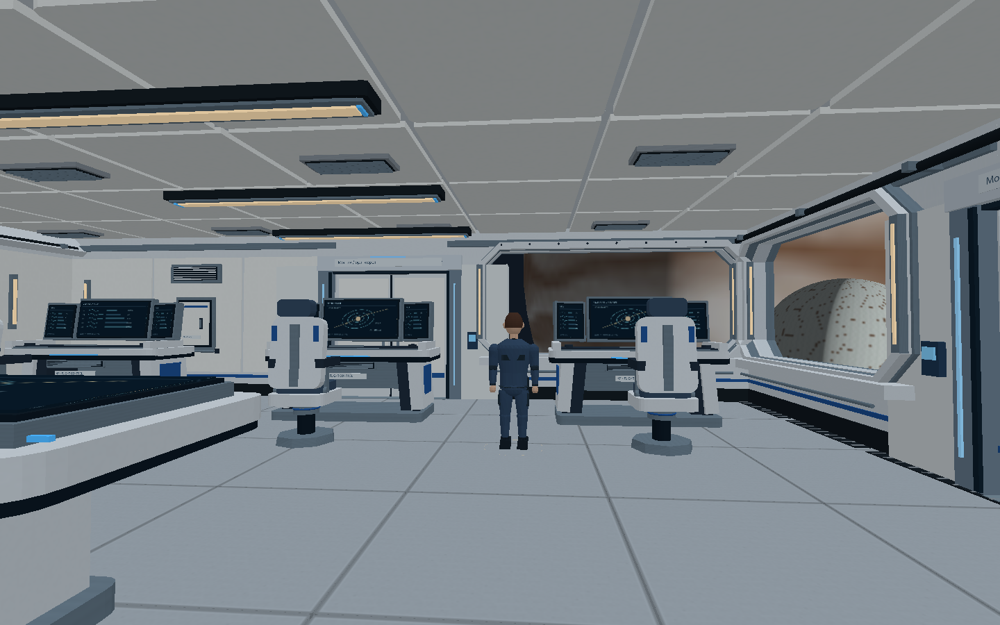
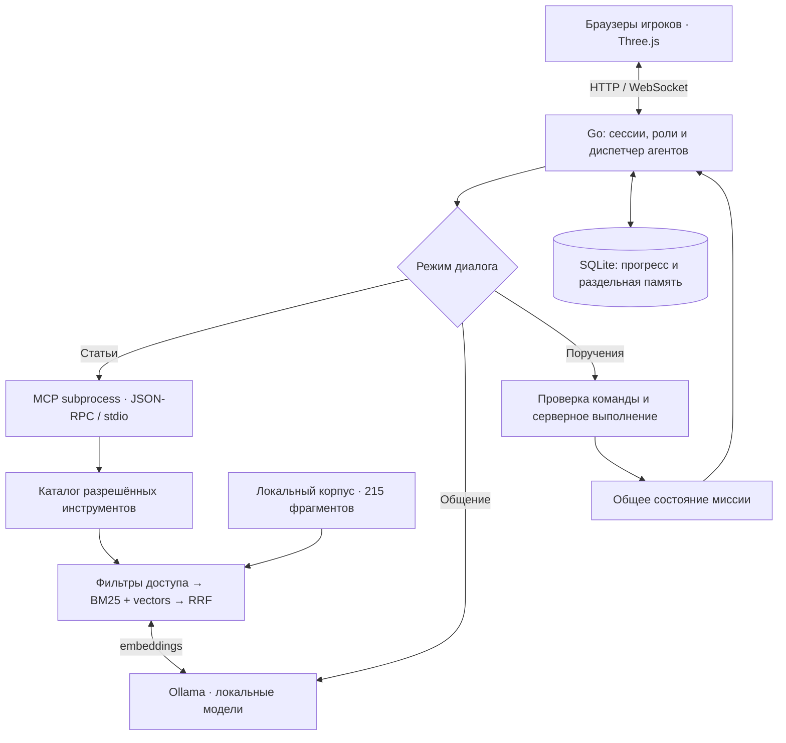

# AgentDeck

Кооперативная образовательная среда с ролевыми ИИ-агентами, MCP и гибридным RAG.


[](go.mod)
[](web/)
[](.env.example)
[](go.mod)
[](https://github.com/notbrokenprogrammer/hackathon-2026-agentdeck-mcp-rag/actions/workflows/go.yml)

[Быстрый запуск](#быстрый-запуск) · [Демонстрация](#демонстрация-за-5-минут) · [Технологии](#ключевые-технологии) · [Проверки](#воспроизводимые-проверки) · [Архитектура](docs/architecture.md)

**AgentDeck** — прототип кооперативной образовательной среды для 1–4 игроков.
На борту корабля «Горизонт–7» команда восстанавливает системы, проводит эксперименты
и обращается к четырём ИИ-наставникам. Агенты находят материалы через RAG,
используют инструменты MCP и помогают действовать в общей симуляции.

Проект связывает поиск информации, объяснение и выполнение действий в симуляции.
Результаты операций отражаются в состоянии миссии: восстановление охлаждения,
создание эксперимента и синхронизация изменений между игроками.



*Офлайн-рендер ресурсов игрового мира. В интерфейсе и исходниках также сохранено название LastCrew FlightDeck.*

## Принцип работы

В учебном диалоге важно понимать, откуда взялся ответ и что произошло после команды.
AgentDeck связывает разговор с документами и состоянием симуляции:

1. Игрок выбирает наставника и режим: **статьи**, **общение** или **поручение**.
2. Сервер определяет доступный контекст: персонажа, игрока, партию и открытые факты.
3. Агент получает разрешённые источники или инструменты для текущей задачи.
4. Интерфейс показывает источники ответа, состояние поиска либо подтверждение операции сервером.
5. Результат действия синхронизируется между участниками и сохраняется.

## Ключевые технологии

| Технология | Роль в проекте |
|---|---|
| **Ролевые ИИ-агенты** | Четыре профиля, области знаний, наборы инструментов и раздельная память диалогов |
| **MCP — Model Context Protocol** | JSON-RPC через stdio; запуск дочернего процесса, `initialize`, `tools/list`, `tools/call`; доступ к знаниям и инструментам |
| **Гибридный RAG** | BM25 + векторы Ollama + косинусная близость + Reciprocal Rank Fusion; фильтрация доступа до ранжирования |
| **Ollama** | Локальная генерация: `qwen3:4b-instruct-2507-q4_K_M`; embeddings: `embeddinggemma` |
| **Go** | HTTP/WebSocket-сервер, диспетчеризация агентов, проверки прав, игровые правила и расчёты |
| **SQLite** | Аккаунты, партии, прогресс и история; восстановление после перезапуска |
| **JavaScript + Three.js** | Браузерный 3D-клиент, взаимодействия, потоковая загрузка мира и программный рендер |
| **Автоматические проверки** | Go tests, race detector, тесты клиента, реальный MCP subprocess и smoke-тест собранного сервера |

В `knowledge/` — **215 фрагментов**: сценарий миссии, материалы наставников и учебный
материал для лаборатории. Корпуса трёх наставников содержат **60 документов / 163 фрагмента**;
происхождение и тип материалов указаны в [каталоге источников](knowledge/sources/crew/SOURCES.md).

## Возможности прототипа

### Три режима с разными полномочиями

| Режим | Контекст и поведение |
|---|---|
| **По статьям** | Поиск доступных документов, ссылки на фрагменты; при отсутствии материалов — `no_sources`. Изменение мира запрещено. |
| **Неформальное общение** | Персона и собственная история разговора; без RAG, MCP-инструментов и состояния миссии. |
| **Поручения** | Состояние миссии, прогноз операции и выполнение явно порученного действия. Успех подтверждает сервер. |

История разделена по комнате, поколению миссии, игроку, персонажу и режиму.
Агенты используют общий локальный сервис модели, сохраняя разные роли и контекст.
Автономное обсуждение задач между агентами пока не реализовано: их работу направляют игрок и сервер.

### RAG с контролем доступа и явным резервным режимом

Перед BM25 и векторным ранжированием отбираются документы, доступные персонажу
и текущей партии. Ограничения действуют также при чтении фрагмента по ID.
Если embeddings недоступны, поиск возвращает `bm25_fallback` с причиной.
Готовность кэша и успешный гибридный поиск в конкретном запросе показываются отдельно.

### Действия с подтверждённым результатом

Модель выбирает разрешённый инструмент; роль, ресурсы, версию состояния и условия
выполнения проверяет сервер. Вопрос «Как запустить реактор?» и просьба
«Не запускай реактор» не должны запускать операцию. Текстовое заявление модели
«Готово!» само по себе не считается подтверждением.

### Локальный запуск и устойчивость к отказам

Модели и база знаний работают на компьютере ведущего. При недоступной модели
сохраняются справочный поиск, игровые правила и поддерживаемые точные команды.
В свободном общении показывается ошибка доступности модели. Гостям нужен браузер.

## Архитектура



Для ответов по статьям найденные фрагменты передаются модели; при отказах доступны
справочные ответы. Каталог инструментов поддерживает резервный вызов внутри хоста,
если MCP subprocess недоступен. Поручения режима миссии проходят отдельный серверный
обработчик; схема не подразумевает, что каждое изменение мира выполняется через MCP.

## Проверенные гипотезы

Ниже — **технические гипотезы, подтверждённые автоматическими проверками**.
Модельные ответы и embedding-векторы в соответствующих тестах задаются контролируемым
HTTP-транспортом. Это проверяет интеграцию и ограничения, но не качество реальных весов.

| Гипотеза | Результат проверки | Тесты |
|---|---|---|
| MCP можно включить в рабочий цикл игры | Handshake, вызов инструментов и чистый JSON-RPC через настоящий дочерний процесс | [Проверка launcher](scripts/test-launcher.py), [smoke-тест](cmd/smoke-release/main.go) |
| Семантический поиск способен найти фрагмент без общего слова с запросом | Векторное совпадение и объединение рангов RRF работают на заданных векторах | `TestHybridSemanticOnlyMatchUsesRealEmbeddingProtocol`, `TestHybridReciprocalRankFusion` в [hybrid_test.go](internal/rag/hybrid_test.go) |
| Ограничения доступа сохраняются при гибридном поиске | Закрытые кандидаты отфильтрованы до обоих ранжирований; чтение по ID также проверяет доступ | [Фильтрация RAG](internal/rag/access_test.go), `TestHybridFiltersBeforeBothRankingsAndLazyEmbedding` |
| Разделение режимов предотвращает смешивание контекста | Свободный разговор не получает документы и инструменты; истории режимов сохраняются отдельно после перезапуска | [Тесты режимов](internal/npc/dialogue_modes_test.go), [память](internal/npc/memory_test.go) |
| Агент не должен объявлять действие выполненным без результата сервера | Вопросы, отрицания и неподтверждённые заявления модели не меняют мир; результат берётся из серверного ответа | [Тесты поручений](internal/npc/commands_test.go) |
| Отказ модели не должен останавливать справочную помощь | Проверены переход на BM25, явные причины отказа, ответы по источникам и отмена запросов | [Hybrid fallback](internal/rag/hybrid_test.go), [ответы без модели](internal/npc/fallback_test.go) |
| Одна симуляция может обслуживать нескольких игроков с восстановлением | Два реальных WebSocket-клиента, общие изменения, изоляция партий и восстановление SQLite | [Интеграционные тесты](internal/server/release_test.go), [smoke-тест](cmd/smoke-release/main.go) |

**Открытые гипотезы:** улучшает ли такой формат обучение; повышает ли RAG точность
ответов на реальных вопросах; насколько полезны разные роли наставников.
Для этого нужны пользовательское исследование, размеченный набор вопросов и сравнение
с базовым вариантом. В этом репозитории нет заявлений о доказанном образовательном эффекте,
проценте точности LLM или гарантированном отсутствии галлюцинаций.

## Демонстрация за 5 минут

1. Создайте экспедицию, выберите роль и запустите миссию; откройте её во втором браузере.
2. В режиме статей спросите наставника о его области знаний и покажите источники ответа.
3. Переключитесь в свободное общение: у него отдельная история и нет доступа к игровым действиям.
4. В режиме поручений сравните «Как запустить реактор?» и «Восстанови охлаждение».
   Покажите прогноз или серверный результат с учётом роли и состояния миссии.
5. Покажите общее изменение второму игроку, затем диагностический статус ИИ и поиска.

При подготовленных моделях используйте полный режим. Для демонстрации без Ollama
доступны справочные ответы и точные игровые команды; свободная генерация требует модели.

## Быстрый запуск

Нужны **Go 1.23+** и современный браузер. Node.js и Python требуются только для разработки
и дополнительных проверок. При первой сборке нужен доступ к зависимостям Go.

```sh
git clone https://github.com/notbrokenprogrammer/hackathon-2026-agentdeck-mcp-rag.git
cd hackathon-2026-agentdeck-mcp-rag
go run .
```

Откройте **http://localhost:8080**. Создайте аккаунт → экспедицию → выберите роль →
«Я готов» → «Начать миссию». Для одиночной игры есть роль «Управлять всеми системами».
Остановка — **Ctrl+C**. Запускайте из корня проекта: нужны папки `world/` и `knowledge/`.

Локальные ИИ-наставники используют отдельно запущенную Ollama:

```sh
ollama pull qwen3:4b-instruct-2507-q4_K_M
ollama pull embeddinggemma
go run ./cmd/check-agents -prepare
go run ./cmd/check-agents -status
go run .
```

Запуск без моделей в macOS/Linux:

```sh
OLLAMA_ENABLED=false RAG_HYBRID_ENABLED=false go run .
```

В PowerShell задайте `$env:OLLAMA_ENABLED = "false"` и `$env:RAG_HYBRID_ENABLED = "false"`
перед `go run .`. Настройки перечислены в [.env.example](.env.example);
`.env` автоматически не загружается.

Для сборки: `go build -o lastcrew .`, затем `./lastcrew`.
На Windows: `go build -o lastcrew.exe .`, затем `.\lastcrew.exe`.
Стартовые скрипты используют бинарники из `bin/`, если они есть, иначе — Go.
Готовые бинарники и веса моделей в репозиторий не входят.

**Управление:** WASD — движение, мышь — обзор, Shift — бег, E — взаимодействие,
G — положить предмет, Esc — освободить курсор. Для движения выберите «Исследовать».

**Сеть:** гостям нужны адрес ведущего и отдельный аккаунт. Для временного HTTPS-приглашения:
`go run . --install-tunnel`, затем `go run . --share`.
[Подробное руководство](docs/NETWORK_AND_AGENTS.md).

## Воспроизводимые проверки

```sh
go test ./...
go vet ./...
go test -race ./...
npm test
python3 scripts/build_crew_corpus.py --check

go build -o lastcrew .
python3 scripts/test-launcher.py ./lastcrew
go run ./cmd/smoke-release ./lastcrew
```

Тестам интерфейса нужен **Node.js 24+**; `npm install` для основного набора не требуется.
На Windows в проверках бинарника используйте `./lastcrew.exe`.
[GitHub Actions](.github/workflows/go.yml) настроен на Go-проверки в Linux, Windows и macOS,
проверку интерфейса и корпуса, а также smoke-тест в Linux.

Локально проверены Go tests, vet, race detector, тесты интерфейса, корпус, MCP и
скомпилированный сервер. Работа на реальных весах, публичный туннель, физическая LAN
и аппаратный FPS требуют отдельной проверки на демонстрационном оборудовании.
Старые отчёты в `docs/` относятся к соответствующим версиям проекта.

## Разработка и структура

| Каталог | Назначение |
|---|---|
| `internal/npc/`, `internal/agents/`, `internal/crew/` | Диалоги, память, роли и диспетчеризация |
| `internal/mcp/`, `internal/mcpapp/`, `internal/knowledge/` | MCP и каталог инструментов |
| `internal/rag/`, `knowledge/` | Гибридный поиск, корпус и сведения об источниках |
| `internal/mission/`, `internal/game/`, `internal/server/` | Правила, действия, общий мир и сеть |
| `web/`, `world/`, `world_source/` | Клиент, готовые ресурсы и их генерация |
| `scripts/`, `contracts/`, `examples/` | Проверки, сборка, контракты и примеры |

`npm run dev` запускает разработку на порту 4173 с отдельными сохранениями.
Для генерации ресурсов установите зависимости `npm install`, затем выполните
`npm run build:world` и `npm run review:interior` для обновления планов загрузки.
Сборки для Linux x64, Windows x64 и macOS arm64: `python3 scripts/build-all.py`.

## Данные и источники

Аккаунты, сессии, диалоги и прогресс сохраняются локально в `data/`; эта папка,
кэш, `.env`, приватные ключи, логи и исходные ZIP-архивы исключены из Git.
Репозиторий содержит исходники, игровые материалы и тестовые примеры.
Перед публикацией доступна проверка `python3 scripts/check-publication.py --staged`.

Персонажи — учебные образы; игровые роли не являются биографическими утверждениями.
[Происхождение ассетов](docs/ASSETS.md), [источники корпуса](knowledge/sources/crew/SOURCES.md),
[лицензия Three.js](licenses/THREE-MIT.txt), [лицензия шрифтов Geist](web/css/fonts/OFL.txt).

Дополнительно: [запуск и производительность](docs/RUN_RU.md),
[MCP и RAG](docs/mcp-rag.md), [режимы и гибридный поиск](docs/CHAT_HYBRID_UPDATE.md),
[архитектура](docs/architecture.md), [протокол](docs/protocol.md).
